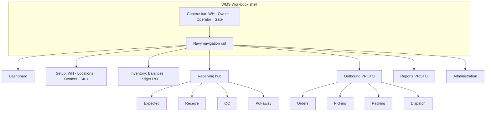
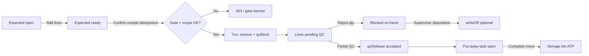
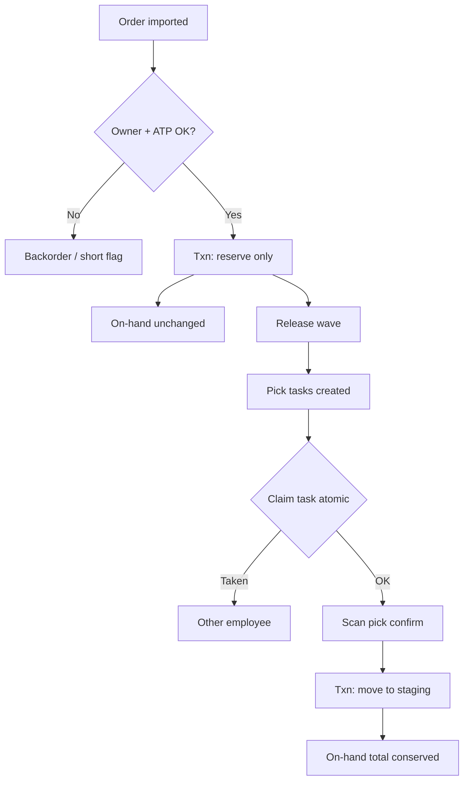
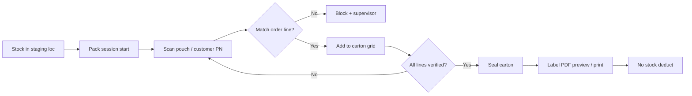
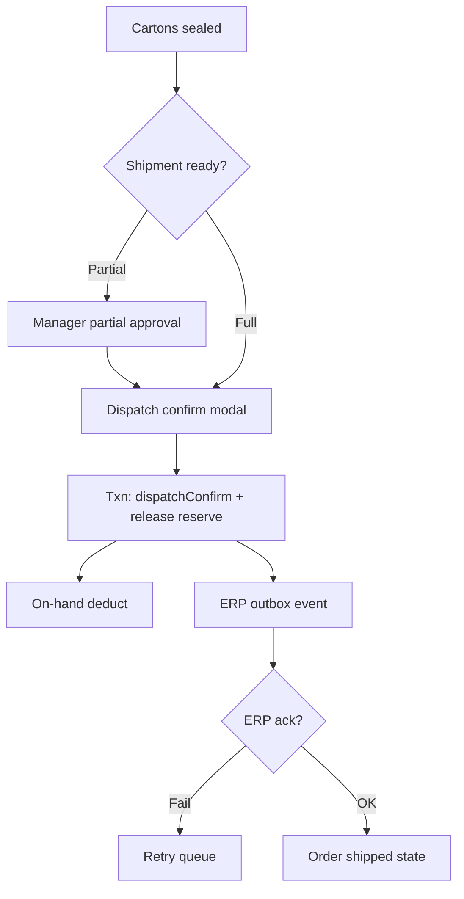
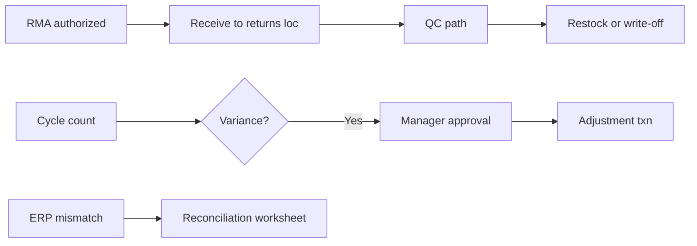
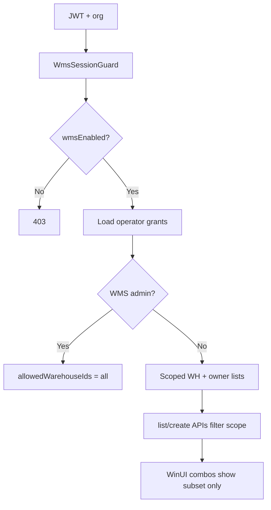
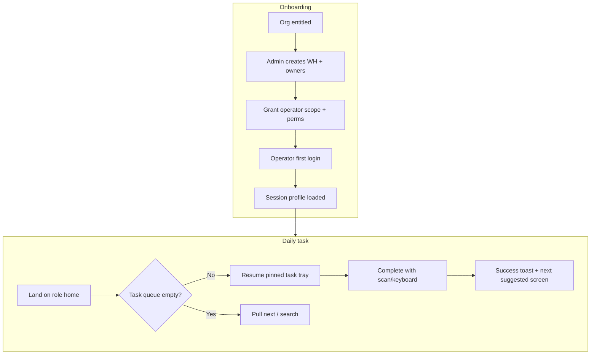

# FLOW-05 — Visual flowcharts

Reviewable Mermaid diagrams. **Green paths** = LIVE (03A); **dashed** = PLANNED.

---

## 1. Overall Warehouse Workbook

---

## 2. Receiving → QC → Put-away (LIVE)

---

## 3. Order → Reservation → Picking (PLANNED)

---

## 4. Picking → Packing → Label printing (PLANNED)

---

## 5. Packing → Dispatch → ERP confirmation (PLANNED)

---

## 6. Returns and reconciliation (PLANNED)

---

## 7. 3PL client isolation and permissions

---

## 8. Employee onboarding and daily task flows

---

## Diagram notes for product review

| # | Key decision |
|---|----------------|
| 3 | Reservation never deducts on-hand. |
| 4 | Packing verifies; does not deduct. |
| 5 | **Only** dispatch confirms deduct. |
| 7 | Matches `WmsSessionGuard` + list filters (LIVE). |

---

*Roles:* [FLOW-02-user-roles-and-journeys.md](./FLOW-02-user-roles-and-journeys.md)  
*UX handoff:* [FLOW-06-ux-handoff.md](./FLOW-06-ux-handoff.md)