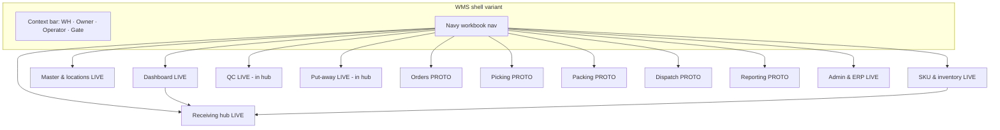

# UX-05 — Prototype Review & Acceptance Standards

**Phase:** UX-01 Product Design Foundation  
**Status:** Ready for product-owner review  
**Production impact:** None — no WinUI XAML or backend posting logic was changed for UX-01.

---

## 1. Deliverable index

| Document | Purpose |
|----------|---------|
| [UX-01-design-audit.md](./UX-01-design-audit.md) | As-is WinUI audit (shell, Master Data grid, Workbook gaps) |
| [UX-02-design-system.md](./UX-02-design-system.md) | Tokens, themes, density, status colors (proposal) |
| [UX-03-screen-blueprints.md](./UX-03-screen-blueprints.md) | Twelve workbook screens — roles, columns, LIVE vs PROTO |
| [UX-04-interaction-standards.md](./UX-04-interaction-standards.md) | Grid strategy, workflows, a11y, i18n, error recovery |
| **This file** | Prototype access, screenshots policy, acceptance matrix, PO checklist |

---

## 2. Visual prototype (runnable)

| Asset | Description |
|-------|-------------|
| [prototypes/partfinder-warehouse-ux-preview.html](./prototypes/partfinder-warehouse-ux-preview.html) | Interactive static mock (navy nav, teal primary, five panes) |

**How to preview**

1. From repo root, open the HTML file in **Microsoft Edge** or **Chrome** (double-click or `file://` URL).
2. Use the left rail to switch: **Dashboard**, **Inventory**, **Receiving**, **Picking (proto)**, **Packing (proto)**.
3. Compare layout and tokens to [UX-02-design-system.md](./UX-02-design-system.md).

**WinUI 3 application screenshots**

- **Not captured in this workspace.** Cursor agents did not run the packaged PartFinder desktop app or capture live screen captures.
- The HTML preview is an **explicit design mock**, not a photograph of production UI. Per UX-01 stop condition, production Workbook appearance remains the current ListView-based implementation until PO sign-off on rollout.

**Future WinUI spike (post UX-01 approval)**

- Optional hidden route `WmsDesignPreviewPage` (feature flag) mirroring HTML panes — out of scope until authorized.

---

## 3. Information architecture (target)

---

## 4. Prototype screen ↔ blueprint mapping

| HTML pane | UX-03 section | LIVE / PROTO |
|-----------|---------------|--------------|
| Dashboard | §1 Warehouse Dashboard | LIVE (enhance) |
| Inventory explorer | §3 SKU Registry & Inventory | LIVE |
| Receiving hub | §4 Goods Receiving (+ QC/put-away steps) | LIVE |
| Multi-employee picking | §8 Multi-Employee Picking | PROTO (03B) |
| Packing & pouches | §9 Packing Station | PROTO (04) |

PROTO panes show an **amber prototype banner** in HTML and must use the same banner pattern in WinUI when built.

---

## 5. UX and performance acceptance standards

### 5.1 Workflow efficiency (design goals)

| Workflow | Target steps (happy path) | Target time (trained user) | Measured in UX-01 |
|----------|---------------------------|----------------------------|-------------------|
| Expected ASN → save draft | ≤ 6 clicks | < 90 s | **Not measured** |
| Physical receipt confirm | ≤ 4 clicks after grid filled | < 60 s | **Not measured** |
| QC accept/reject line | ≤ 3 clicks per line | < 20 s / line | **Not measured** |
| Put-away one line | ≤ 3 clicks (scan path) | < 15 s | **Not measured** |
| Find SKU balance | ≤ 2 navigations + search | < 10 s | **Not measured** |

### 5.2 Grid and search (design goals)

| Metric | Goal | Measured in UX-01 |
|--------|------|-------------------|
| First paint 500 rows (client virtualized) | < 400 ms | **Not measured** |
| Sustained scroll | ≥ 55 fps | **Not measured** |
| Worksheet section switch | < 150 ms | **Not measured** |
| Inventory search (debounced) | ≤ 300 ms to results | **Partial** (existing search) |
| Export 10k rows | < 8 s | **Not measured** |

Spikes using Master Data spreadsheet host + WMS row VMs should record actuals in a follow-on **UX-05.1** appendix before grid replacement.

### 5.3 Accessibility (design goals)

| Criterion | Goal | Measured in UX-01 |
|-----------|------|-------------------|
| Keyboard-only primary flows | 100% of LIVE flows | **Not audited** (manual test pending) |
| Focus visibility | Teal 2px ring on all interactive controls | **Not implemented** (token only) |
| Text contrast | WCAG 2.1 AA | **Token check** in UX-02 — not app-wide |
| Screen reader | Named headers and actions on worksheets | **Partial** on current ListViews |

### 5.4 Consistency (design goals)

| Criterion | Goal | Measured in UX-01 |
|-----------|------|-------------------|
| Single worksheet chrome | Title · filter bar · grid · footer across WMS | **Not met** (current Workbook) |
| LIVE vs PROTO distinction | Amber banner on all PROTO screens | **HTML only** |
| Context bar always visible in WMS mode | Warehouse, owner, operator, gate | **Partial** (fields exist; not unified bar) |

### 5.5 Multi-user operations (design goals)

| Scenario | Goal | Measured in UX-01 |
|----------|------|-------------------|
| Idempotent receipt | UI shows “already recorded”, no duplicate anxiety | **Backend supported**; UI copy inconsistent |
| Concurrent edits | 409 toast + refresh | **Specified** in UX-04; not styled |
| Operator grants | Clear 403 with link to Administration | **Partial** (`StatusMessage`) |

### 5.6 Training effort (design goals)

| Criterion | Goal | Measured in UX-01 |
|-----------|------|-------------------|
| Receiving certification | < 2 h with guided hub | **Not measured** |
| Glossary in-app | Help → WMS terms | **Not implemented** |

---

## 6. Grid replacement gate (mandatory before production cutover)

Do **not** replace Workbook ListViews until all of the following are true:

1. Product owner signs UX-02 tokens and UX-03 blueprints for LIVE modules.
2. `WmsDataGrid` spike on Master Data host passes §5.2 grid metrics on reference hardware.
3. License review complete if third-party grid is proposed (default: **no third-party**).
4. Posted-row read-only rules verified in spike (clipboard blocked, lock affordance).
5. Staging E2E receiving path passes [03A-2 staging checklist](../wms-phase03/03A-2-staging-acceptance-report.md) with **new chrome optional**, not blocking.

---

## 7. Product-owner review checklist

- [ ] Approve visual direction (navy rail, teal primary, restrained status palette)
- [ ] Approve LIVE vs PROTO labeling for all 12 workbook modules
- [ ] Approve receiving **hub** consolidation (replace multi-nav hops)
- [ ] Approve grid strategy: **adapt Master Data host** first
- [ ] Approve accessibility bar (keyboard, focus, contrast) for implementation phase
- [ ] Approve HTML prototype as communication baseline until WinUI preview page exists
- [ ] Explicitly **reject or defer** any item that would start Phase **03B** (orders/picking) before UX rollout plan is agreed

**Sign-off fields (fill when reviewed)**

| Reviewer | Date | Decision | Notes |
|----------|------|----------|-------|
| Product owner | | Approved / Changes requested | |
| UX / design | | | |
| Engineering lead | | | |

---

## 8. Stop conditions (confirmed)

| Rule | UX-01 compliance |
|------|------------------|
| Do not replace production UI | **Compliant** — documentation + HTML only |
| Do not alter stock posting / business logic | **Compliant** |
| Do not break existing PartFinder functionality | **Compliant** |
| Do not begin Phase 03B | **Compliant** — picking/packing are PROTO mocks only |

---

## 9. Recommended next steps (after PO approval — not started)

1. **UX-01.1** — Implement `WmsTokens.xaml` + WMS shell variant behind feature flag.
2. **UX-01.2** — Receiving hub layout in WinUI (navigation only; reuse existing ViewModels).
3. **UX-01.3** — Grid spike: `WmsWorksheetGrid` extracted from Master Data patterns.
4. **03A.2** — Complete staging acceptance with current UI; restyle is non-blocking.

---

**Business workflow (FLOW-01):** See `docs/wms-flow/FLOW-06-ux-handoff.md` for connected journeys, ledger rules, and UX-01 screen obligations.

*End of UX-01 deliverable set.*